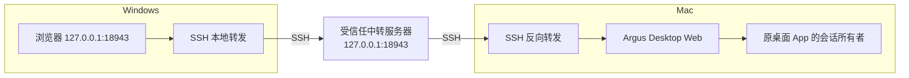

# Argus Desktop Web

在浏览器中继续 Mac 或 Windows Codex 桌面 App 的现有会话。网页在浏览器排版，目标设备保留会话、模型和实际执行；回复通过增量数据回传。支持设备与项目选择、项目内新建对话、草稿、历史分页、追加指令和停止。按设备所有者的选择，Argus 发送默认使用原生完全访问。

这是独立的实验性适配器。目前针对 Codex 桌面版所带 CLI `0.163.0-alpha.10.2` 验证；桌面 follower IPC 不是官方稳定公开 API，App 升级后需要重新检查兼容性。适配器没有复制原 App 的前端包。

## 日常使用

公网部署打开配置的 HTTPS 域名，使用允许的 OJ 账号和原密码登录，再选择 Mac 或 Windows。网页、API 和 WebSocket 均需登录。部署、Windows 受控端及回退方式见 [gateway.md](docs/gateway.md)。下面的本机 SSH 入口仍可使用。

Windows 运行 [Open-Codex-Web.cmd](deploy/windows/Open-Codex-Web.cmd)，打开 `http://127.0.0.1:18943/`。需要 Windows OpenSSH，以及已能免交互登录中转服务器的 SSH 别名 `myten`。可通过 PowerShell 的 `-Relay` 参数换用其他别名。

- 直接选择已有会话继续工作；搜索只搜索已经加载的会话，底部可加载更多。
- 选择项目后点击“新建对话”。首次发送才创建 Mac 会话；草稿保存在当前浏览器。
- 执行中发送会追加指令，停止按钮中断当前回合。
- 新建和继续发送前应用完全访问，并将审批审核者设为用户，不使用模型自动审批。浏览器显示当前权限与发送默认；当前正在执行的回合保留原沙箱，完全访问从下一轮生效。
- 原 App 仍发出的审批会显示原因、完整命令、工作目录、完整请求详情及原生可用选项，点击后回传同一请求。其他复杂请求可以打开原窗口处理。
- Mac 原 App 中尚未发送的草稿没有会话 ID，不能从线程接口自动读取。点击“原窗口与草稿”操作它；网页中的新建草稿与 Mac 原输入框彼此独立。
- 短暂断线自动重连。未知投递结果保留消息编号，不自动重发；可先查看历史或查询投递接口。

运行 [Stop-Connection.cmd](deploy/windows/Stop-Connection.cmd) 停止 Windows 隧道。Mac 上已运行的任务继续执行。Mac 必须登录、保持原 App 运行并可联网；本组件不会绕过锁屏或系统登录。

## 在 Mac 安装

在仓库的 `agentlink` 目录运行：

```bash
bun install --frozen-lockfile
bun run desktop:build
bun run packages/desktop-bridge/deploy/install-mac.ts --revision="$(git rev-parse HEAD)"
curl http://127.0.0.1:18943/api/status
```

安装器只更新 `codes.limen.argus-desktop-web` LaunchAgent。源码和已打包网页复制到 `~/Library/Application Support/ArgusDesktopWeb/releases/`，`current` 指向当前版本；旧版本保留。投递日志在同一根目录的 `delivery.sqlite`，服务日志在 `~/Library/Logs/ArgusDesktopWeb/`。状态接口报告安装版本的 Git SHA 与源码摘要。

直接开发时运行 `bun run desktop:web`。可用 `ARGUS_WEB_PORT`、`ARGUS_WEB_DATA`、`ARGUS_WEB_ASSETS`、`ARGUS_DESKTOP_SOCKET` 指定开发配置；以下安装脚本固定使用默认端口 18943。

## 配置 SSH 中转

Mac 到中转服务器与 Windows 到中转服务器分别使用 SSH。**SSH 在中转服务器终止，因此中转服务器是受信任的一方，这条路径不是端到端加密。** 网页服务和两个转发监听都只绑定回环地址，不需要开放公网控制端口，也不需要把 Mac 私钥交给中转服务器。



1. Mac 为隧道准备专用 Ed25519 密钥，并通过可信渠道核对、保存中转服务器的 SSH 主机公钥。
2. 在中转服务器准备只能通过公钥登录的专用账号。将以下命令生成的**公钥授权行**加入该账号的 `authorized_keys`，保留已有条目：

```bash
bun run packages/desktop-bridge/deploy/relay-key.ts /path/to/tunnel-key.pub
```

生成行包含 `restrict`、强制失败的远程命令和明确的 `permitlisten=127.0.0.1:18943`。私钥只保存在 Mac。要同时转发可选窗口组件，显式加 `--with-viewer`，只额外允许 18942。

3. 在 Mac 安装独立的反向隧道 LaunchAgent：

```bash
bun run packages/desktop-bridge/deploy/install-tunnel.ts \
  --target argus-desktop-web@relay.example.com \
  --key /path/to/tunnel-key \
  --known-hosts /path/to/verified-known-hosts
```

`--key` 和 `--known-hosts` 必须已经存在。安装器使用 `StrictHostKeyChecking=yes`，支持路径中的空格，不自动接受未知主机。

4. 先在中转服务器确认 `curl http://127.0.0.1:18943/api/status`，再从 Windows 运行启动脚本。Windows SSH 登录账号也必须有访问中转服务器回环端口的权限。

## 数据与执行

已有会话的修改只通过原 App 的 follower 接口进行，不调用读取进程的 `turn/start`，也不抢占原 App 的 writer。目录与分页历史通过独立的 app-server 读取。部分版本仍在桌面兼容缓存中保存项目分组，本组件只读取该缓存，将旧项目 ID 映射为 app-server ID，不修改原缓存或 Codex 数据库。

项目内新建会话使用独立的短生命周期 app-server，通过 `thread/start` 创建空会话，设置标题、`thread/unsubscribe`，随后退出创建进程释放 writer。只 unsubscribe 会保留原生的无订阅宽限期，不能当作立即释放写入占用。原 App 打开并接管后，首条消息仍交给原 App 执行。创建编号与消息编号分开持久化，超时不会触发重复创建。

消息 journal 在发送前落盘。相同 ID 与相同内容返回已有状态；相同 ID 配不同内容被拒绝。进程中途重启会把未确认投递标为 `unknown`；只有确认在发送前被阻止的消息允许显式重试。

回复首次发送快照，随后发送带版本号的补丁；长字符串增长时只发送追加字符。版本不连续时重新取快照。它减少界面和传输等待，不改变模型推理速度。

## 完全访问与原生审批

此安装面向设备所有者信任的连接设备。新建会话使用 `approvalPolicy:"never"`、`sandbox:"danger-full-access"`、`approvalsReviewer:"user"`；已有会话发送前，通过原 owner 的 `thread-follower-update-thread-settings` 应用命名权限配置 `:danger-full-access`。不修改用户的全局配置、模型或工作目录。权限设置失败时消息停在发送前，可以明确重试。

追加指令也设置后续权限，并用已观察到的回合 ID 将当前轮的审批审核者改为用户。当前版本的原生接口只能改变当前轮审核者，不能替换当前轮已经开始使用的沙箱；已有步骤和待处理审批仍保留原状态。组件不会为切换权限而停止、重开或重发正在执行的任务，也没有轮询自动批准或调用模型代审批的流程。

完全访问减少沙箱审批，不会使 App 的所有交互消失。Mac 系统授权、连接器交互、显式用户选择及已有待处理审批仍按原 App 的行为处理。审批卡片会保留说明与完整命令；只允许返回当前请求实际提供的选项，过期请求和未提供的操作会被拒绝。

官方说明：[权限配置](https://developers.openai.com/codex/permissions)、[App Server](https://developers.openai.com/codex/app-server)。桌面 follower 的当前轮行为同时依据安装版本生成的协议 schema 与隔离测试核对。

## 本地接口

所有接口要求精确的回环 Host。写操作还要求同源 Origin 和 `/api/session` 发出的随机 `X-Argus-Token`；WebSocket 订阅也验证 token。网页使用 CSP、经过净化的 Markdown，并禁用远程图片加载。

| 方法与路径 | 用途 |
| --- | --- |
| `GET /api/status` | 连通性、安装 SHA、摘要与发送权限默认值 |
| `GET /api/session` | 当前进程的浏览器会话 token |
| `GET /api/projects` | Mac 本地项目 |
| `GET /api/threads?projectId=…&cursor=…` | 会话目录；省略项目表示全部 |
| `GET /api/history?threadId=…&cursor=…` | 分页历史 |
| `POST /api/select` | 请求原 App 打开/接管所选会话 |
| `POST /api/new` | 幂等创建指定项目的空会话 |
| `POST /api/input` | 按唯一编号发送或追加指令 |
| `POST /api/interrupt` | 按预期回合 ID 停止 |
| `POST /api/approval` | 用户显式处理命令/文件审批 |
| `GET /api/delivery/ID` | 查询投递状态 |
| `GET /api/creation/ID` | 查询创建状态 |
| `WS /api/events` | 同源、带 token 的会话订阅 |

协议版本与数据格式见 [protocol.md](docs/protocol.md)，实测范围见 [validation.md](docs/validation.md)。

## 限制与原窗口

提供文本工作流、工具活动摘要和命令/文件审批卡片。附件上传、内嵌浏览器、文件预览、复杂交互、Mac 原输入框草稿和原 App 全部设置仍在原窗口处理。真实审批验证状态见验收文档；完全访问由原生权限设置实现，卡片按钮只转发用户决定。

可选的 [Argus App View 源码与说明](fallback/README.md) 在 18942 转发单个 App 窗口。数据网页不需要屏幕录制或辅助功能权限；只有窗口组件需要。这两个组件可独立停止。

## 升级、回退与检查

更新后重新构建、运行 Mac 安装器并刷新网页。无需替换或重启原 Codex App。不要因为网页更新而重编译已获授权的窗口组件；临时签名变化可能重置 macOS 权限。

停止网页服务：

```bash
launchctl bootout "gui/$(id -u)/codes.limen.argus-desktop-web"
```

停止反向隧道：

```bash
launchctl bootout "gui/$(id -u)/codes.limen.argus-desktop-web.tunnel"
```

回退时先停止网页服务，保留 `delivery.sqlite`，把 `current` 符号链接切回 `releases/` 中所需的完整旧版本，再 `launchctl bootstrap` 加载原 plist。不要删除会话或重置原 App 数据。

```bash
bun test
bun run typecheck
bun run desktop:build
```

完整套件包含 macOS/Unix 路径与 shell 测试，必须在 Mac 的持久工作目录中运行；将 Windows CRLF 工作树直接打包到 Mac，或从 `/tmp` 运行依赖持久目录的发布测试，都会产生环境性失败。Windows 的 `core.autocrlf` 也可能影响 `git archive`，生成验证归档时需显式禁用转换：

```bash
git -c core.autocrlf=false archive --format=tar.gz --output=argus-source.tar.gz HEAD
```

在 Mac 校验归档 SHA256 后解包，保持原始行尾和文件模式。
